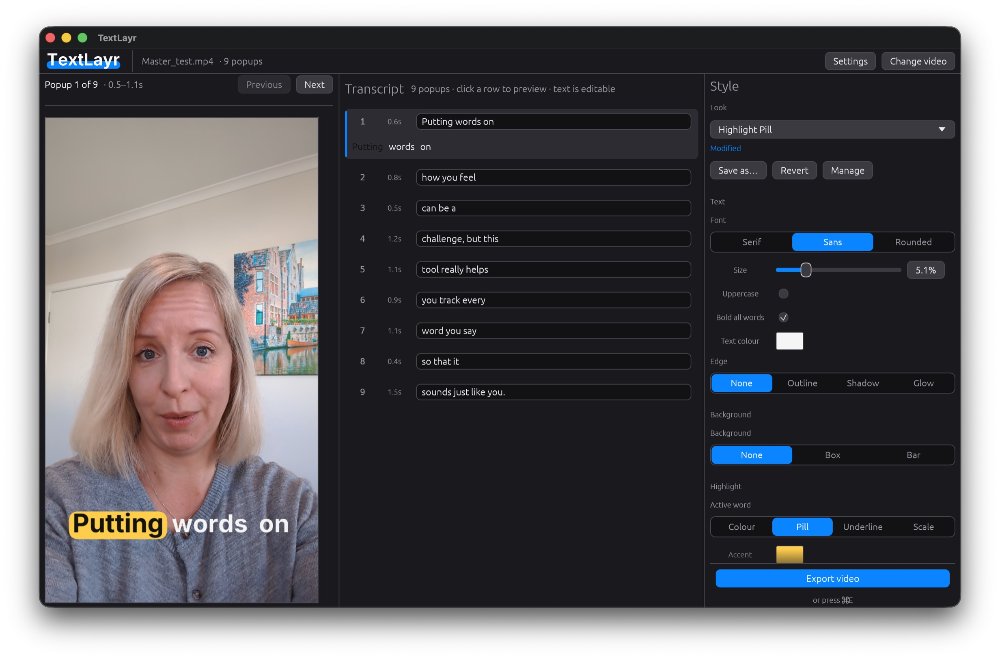

<p align="center">
  <picture>
    <source media="(prefers-color-scheme: dark)" srcset="assets/banner-dark.png">
    
  </picture>
</p>

<p align="center">
  <b>Offline caption burner for short-form video.</b><br>
  Drop in a video, review the transcript, and export with word-by-word captions burned in.<br>
  Free, open source and donation-supported. No uploads, no accounts, and no network after the one-time setup download (beyond an optional once-a-day update check).
</p>

<p align="center">
  <a href="https://paulbuitenhuis.github.io/TextLayr/"></a>
  <a href="LICENSE"></a>
  
  <a href="https://github.com/PaulBuitenhuis/TextLayr/actions/workflows/ci.yml"></a>
</p>

<p align="center">
  
</p>

## What it does

- **Word-by-word captions.** A few words on screen at a time, with the spoken
  word lit up — the karaoke-style look popular on TikTok/Reels/Shorts.
- **Whisper transcription, offline.** Speech-to-text runs locally on your Mac
  via [whisper.cpp](https://github.com/ggerganov/whisper.cpp) with DTW word
  timings for tight sync.
- **Review before you burn.** Edit the transcript, tweak the style, and see a
  live preview before exporting.
- **All the caption styling that matters.** Font, size, uppercase, text and
  accent colours, an outline/shadow/glow edge, an active-word colour, pill,
  underline or scale, a box or bar background with colour, opacity, corners,
  padding and shadow, position, width, one to three lines, motion and
  words per popup.
- **Layout that stays put.** One, two or three lines; the caption shrinks to fit
  or wraps at the chosen width, and can be aligned left, centre or right. A bar
  background gives lower-thirds a fixed width.
- **Entrances and exits that move.** Pop, slide or fade a caption in and out,
  with a slow, normal or fast speed. The Motion controls play in → hold → out in
  the live preview.
- **Style profiles.** Save the current look and caption mode as a named profile,
  start from eight built-in looks, and update, rename or delete your own. Pick
  one from the Look dropdown; the preview updates immediately. A profile can
  also change how many words share a popup, with an inline choice before it
  replaces transcript edits.
- **Also a CLI.** The same pipeline is available headlessly for scripting.

## Requirements

- **macOS 13 (Ventura) or later on Apple Silicon (arm64).** (The code also runs on
  Linux for development; release builds target macOS.)
- **No extra installs.** `ffmpeg` + `ffprobe` and a whisper model are fetched on
  first run (~190 MB, or ~530 MB if you pick the larger `small.en` model). If you
  already have ffmpeg on your `PATH` (e.g. from Homebrew), TextLayr uses it
  instead of downloading one.
- **About 250 MB of disk** after setup (~600 MB with `small.en`).

## Install

TextLayr is free and open source, so it isn't signed with a paid Apple Developer
ID and can't be notarized. macOS therefore refuses to open it the way it opens a
paid app. There are two ways in — the disk image is the normal one, and the
terminal script avoids the warning entirely.

### Disk image — point and click

Download the latest `TextLayr-<version>.dmg` from
[Releases](https://github.com/PaulBuitenhuis/TextLayr/releases), or use the
stable link:
[TextLayr.dmg](https://github.com/PaulBuitenhuis/TextLayr/releases/latest/download/TextLayr.dmg).
Then:

1. **Drag TextLayr into Applications before opening it.** Launching it from the
   disk image makes macOS run it from a temporary read-only copy, which stops it
   updating itself later.
2. **Open it from your Applications folder.** macOS blocks the first launch:

   1. Double-click it, then click **Done** in the warning — don't choose *Move
      to Trash* (some Macs say *Move to Bin*).
   2. Open   → **System Settings → Privacy & Security** and scroll to
      **Security**.
   3. Click **Open Anyway** next to the message about TextLayr, enter an admin
      password, and confirm.
   4. Open the app again.

   It has to be an admin account, and the **Open Anyway** button only shows for
   about an hour after the blocked attempt. macOS 15 removed the old
   "right-click → Open" shortcut, which is why this goes via System Settings now.

   **No button, or you'd rather not?** Clear the flag instead:

   ```sh
   xattr -dr com.apple.quarantine /Applications/TextLayr.app
   ```

   Swap in `~/Applications` if that's where you put it. If macOS says TextLayr
   **"is damaged and can't be opened"**, that's the same mechanism and the same
   command fixes it.

   **Already installed and still getting the warning?** Run the terminal
   installer below — it replaces the app and clears the flag.

You only ever do this once. After the first launch TextLayr updates itself, and
the app downloads those updates itself — so they never trip Gatekeeper.

Step-by-step guide with pictures:
<https://paulbuitenhuis.github.io/TextLayr/#install> — or the printable
[PDF guide](https://paulbuitenhuis.github.io/TextLayr/assets/install/TextLayr-install-guide.pdf).

### Terminal — no warnings, no password

```sh
curl -fsSL https://paulbuitenhuis.github.io/TextLayr/install.sh | sh
```

Files fetched with `curl` don't carry the `com.apple.quarantine` flag that
browsers and AirDrop add to downloads, so Gatekeeper is never consulted: TextLayr
installs and opens like any other app. The script reads the same release manifest
the app's own updater trusts, checks the download's SHA-256, unpacks it with
`ditto` (which preserves the code signature) and installs to `/Applications` — or
`~/Applications` when `/Applications` isn't writable. It never asks for a
password. Read it first if you prefer:

```sh
curl -fsSL https://paulbuitenhuis.github.io/TextLayr/install.sh | less
```

Options go through `sh -s --`, e.g. `... | sh -s -- --dir ~/Applications
--no-open`. `--cli` also puts a `textlayr` command on your `PATH`
(`/usr/local/bin` when writable, otherwise `~/.local/bin`). `--version <x.y.z>`
installs a specific release, and `--uninstall` removes the app and everything
TextLayr downloaded (it also removes your preferences):

```sh
curl -fsSL https://paulbuitenhuis.github.io/TextLayr/install.sh | sh -s -- --uninstall
```

### Uninstall

1. Quit TextLayr and drag **TextLayr.app** to the Trash — from `/Applications`,
   or `~/Applications` if that's where it went.
2. Remove what TextLayr downloaded (~250 MB, or ~600 MB with `small.en`). Either
   **Settings → Diagnostics → Remove downloaded models and ffmpeg** (this keeps
   your style preferences), or delete the folder itself: Finder → **Go → Go to
   Folder** (⇧⌘G) → `~/Library/Application Support/textlayr` (this also resets
   preferences). The transcript cache in `~/Library/Caches/textlayr` is optional
   and safe to delete too.

The terminal installer can do all of it for you (including preferences):
`curl -fsSL https://paulbuitenhuis.github.io/TextLayr/install.sh | sh -s -- --uninstall`.
Videos you exported (`<name>_textlayr.mp4`) are never touched.

### First run

The first time you open TextLayr it shows a **Setup** screen. It needs an internet
connection once and downloads:

- `ffmpeg` + `ffprobe` (unless it finds them on your `PATH`, e.g. via Homebrew)
- a whisper model — **base.en** by default (~148 MB, fast); **small.en**
  (~488 MB, more accurate) is selectable on the same screen.

That is ~190 MB for the default choice, or ~530 MB with `small.en`. These are
stored in `~/Library/Application Support/textlayr/`, next to your preferences and
saved style profiles (`profiles/`). The only other thing TextLayr writes is a
small transcript cache in `~/Library/Caches/textlayr/`. From then on it works
fully offline, apart from a once-a-day look for a new TextLayr release (you can
switch that off in **Settings → Updates**).

You can manage models from the **Settings** window: switch between installed
ones, download the other, or remove one TextLayr downloaded (a dev-checkout or
`$TEXTLAYR_MODEL` model is never deleted). **Settings → Diagnostics** can remove
all downloaded dependencies at once.

Prefer the terminal? The GUI install doesn't put `textlayr` on your `PATH` — see
[Command line](#command-line) for the bundle path, or re-run the installer with
`--cli`.

## Using the app

1. **Drop a video** (or pass a path on the command line).
2. Wait while it extracts audio and transcribes. Progress is shown per phase.
3. **Review** the transcript: click a chunk to jump the preview to it, edit any
   text, and adjust the style in the right-hand panel. Everything is inline —
   there is no separate editor window covering the preview.
4. **Export** (button or **⌘E**). The result is written next to the input as
   `<name>_textlayr.mp4`, with a **Reveal in Finder** shortcut when it's done.

A transcript is cached per input file (and per model), so re-rendering or
restyling after the first pass is instant.

### Style controls

The right-hand panel exposes about twenty visual decisions, all in one scroll:

- **Look** — pick a built-in or saved profile from the dropdown.
- **Text** — font, size, uppercase, bold, text colour, edge and strength.
- **Background** — none, box or bar, with colour, opacity, corners, padding and
  shadow.
- **Highlight** — the active word as colour, pill, underline or scale, plus the
  accent colour.
- **Placement** — vertical position, width, alignment and one to three lines.
- **Motion** — none, pop, slide or fade, with a speed and preview.
- **Caption** — words per popup.

The panel derives the detailed fields — outline width, shadow geometry, pill
padding, line height, reserved lines, easing and so on — from those choices, so
the preview stays coherent. The underlying style model still stores them, so
profiles and the CLI remain exact; the panel simply stops asking you to manage
every parameter by hand.

### Style profiles

The **Look** dropdown at the top of the style panel lists your profiles and the
built-ins. Choosing one applies it and updates the preview immediately; there
are no thumbnail previews to browse.

- **Save as…** snapshots the current look and caption mode under a name. The
  name field appears inline in the panel.
- **Save** updates one of your own profiles; **Revert** discards changes made
  since it was applied.
- **Manage** opens an inline list of your profiles with **Rename** and **Delete**.
  Built-ins are read-only; save one under a new name to customise it.
- A profile can carry a caption mode (words per popup). If applying one would
  re-chunk an edited transcript, the panel offers **Apply both**, **Look only**
  or **Cancel** inline — no dialog.
- If a built-in changes in an app update, an active copy shows **modified**;
  **Revert** applies the new version.
- Profiles live as one JSON file each in
  `~/Library/Application Support/textlayr/profiles/`, so they can be backed up
  or copied between machines. Every config save also keeps the previous document
  as `config-v3.bak` next to `config.json`.

### Updates

TextLayr reads a small `latest.json` manifest attached to the newest GitHub
release, on launch (at most once a day), and shows an **Update available** button
next to **Settings** when there is a newer version. From **Settings → Updates**
you can check on demand, read the release notes, or **Download & install** — the
app verifies the download (SHA-256 from the manifest, plus a codesign /
bundle-identifier / version check), swaps its own bundle in place and relaunches
itself. If it can't (e.g. it is running from a quarantined "App Translocation"
copy or a read-only location), it downloads the disk image and opens it so you
can drag **TextLayr** into **Applications** by hand.

Automatic checking can be turned off with the **Check automatically** box; the
check is the only time TextLayr talks to the network after setup.

## Command line

The app bundle doesn't add itself to your `PATH`. If you installed the disk
image, run the binary directly — or re-run the installer with `--cli` to install it
(it prints the `PATH` hint if `~/.local/bin` isn't on it):

```sh
/Applications/TextLayr.app/Contents/MacOS/TextLayr --version
```

Built from source (`cargo build --release`), the binary is
`target/release/textlayr`, so the examples below apply as written.

```sh
textlayr # open the GUI
textlayr video.mp4                          # GUI, pre-loaded with a video
textlayr video.mp4 --headless               # run the whole pipeline, no GUI
textlayr video.mp4 --words                  # print the (word, start, end) table and stop
textlayr --setup                            # download ffmpeg + model, then exit
textlayr --check-updates                    # check GitHub for a newer release (exit 10 if behind)
textlayr --version                          # version + build hash
```

| Option | Effect |
|---|---|
| `--headless` / `--gui` | Force CLI / GUI mode when both would apply |
| `--words` | Print the word-timing table and stop |
| `--no-cache` | Ignore the cached transcript and re-transcribe |
| `-o, --output <path>` | Output path (default `<input>_textlayr.mp4`) |
| `--model <base.en\|small.en>` | Whisper model to use |
| `--png-dir <dir>` | Render caption states + filter script, skip encoding |
| `--transcript <json>` | Skip whisper: read `{text,start_secs,end_secs}` word timings from a file (testing/CI) |
| `--font <family>` | `Libre Baskerville` (default) · `Inter` · `Nunito` |
| `--font-size <pct>` | Glyph size as % of frame height (default 3.4) |
| `--position <pct>` | Caption box centre as % of frame height (default 72) |
| `--words-per <n>` | Words per popup, 1–8 (default 3; 1 is word-by-word) |
| `--profile <id\|path>` | Start from a built-in/saved profile, or a profile JSON file |
| `--list-profiles` | List built-in and saved profiles, then exit |
| `--encoder <name>` | `auto` (default) · `vaapi` · `videotoolbox` · `x264` |
| `--graph` | Legacy overlay-graph encoder (higher RAM; motion effects need the default pipe) |
| `--setup` | Download missing dependencies and exit |
| `--check-updates` | Check GitHub for a newer release and exit (0 up to date, 10 update available, 1 error) |
| `-V, --version` | Print the version and build hash |

## Building from source

See [CONTRIBUTING.md](CONTRIBUTING.md) for the prerequisites and the test suite.
In short:

```sh
cargo build --release          # -> target/release/textlayr
scripts/package_macos.sh       # -> dist/TextLayr.app (+ .zip, .dmg)
```

To exercise the in-app updater without publishing a release, `scripts/serve_updates_local.sh`
packages a higher-versioned build, writes a matching `latest.json` and serves
`dist/` over HTTP; run a scratch copy of the app with `TEXTLAYR_UPDATE_URL`
pointed at it (the script prints the exact command).

## How it works

`ffprobe` (display dimensions + rotation) → audio extract → whisper
transcription with DTW word timings → chunking into popups → per-word caption
PNGs → export: ffmpeg decode → Rust compositing → hardware encode
(VideoToolbox on macOS; x264 fallback), audio copied.

Caption states are tight crops of just the caption box, so a few hundred of them
stay small and the export's memory stays flat. See
[CONTRIBUTING.md](CONTRIBUTING.md) for the deeper architecture notes.

## Support

[](https://ko-fi.com/U6R0290CU2)

TextLayr is free, open source and donation-supported, and always will be. If it
saves you time, you can buy me a coffee - it's completely optional. Starring or
sharing the project helps just as much. Support is for the software as it is: it
doesn't buy features, priority, or a place on the roadmap.

## Contributing

Bug reports and feature ideas are welcome. TextLayr is a single-author project
and doesn't take unsolicited pull requests — see
[CONTRIBUTING.md](CONTRIBUTING.md#contribution-policy) for what to do instead.

## License

[MIT](LICENSE). Bundled fonts are under the SIL Open Font License — see
[`assets/fonts/OFL.txt`](assets/fonts/OFL.txt) and
[THIRD_PARTY_LICENSES.md](THIRD_PARTY_LICENSES.md).

textlayr invokes `ffmpeg`/`ffprobe` and the whisper model as separate programs; it
does not link them, and they are not distributed with TextLayr.
