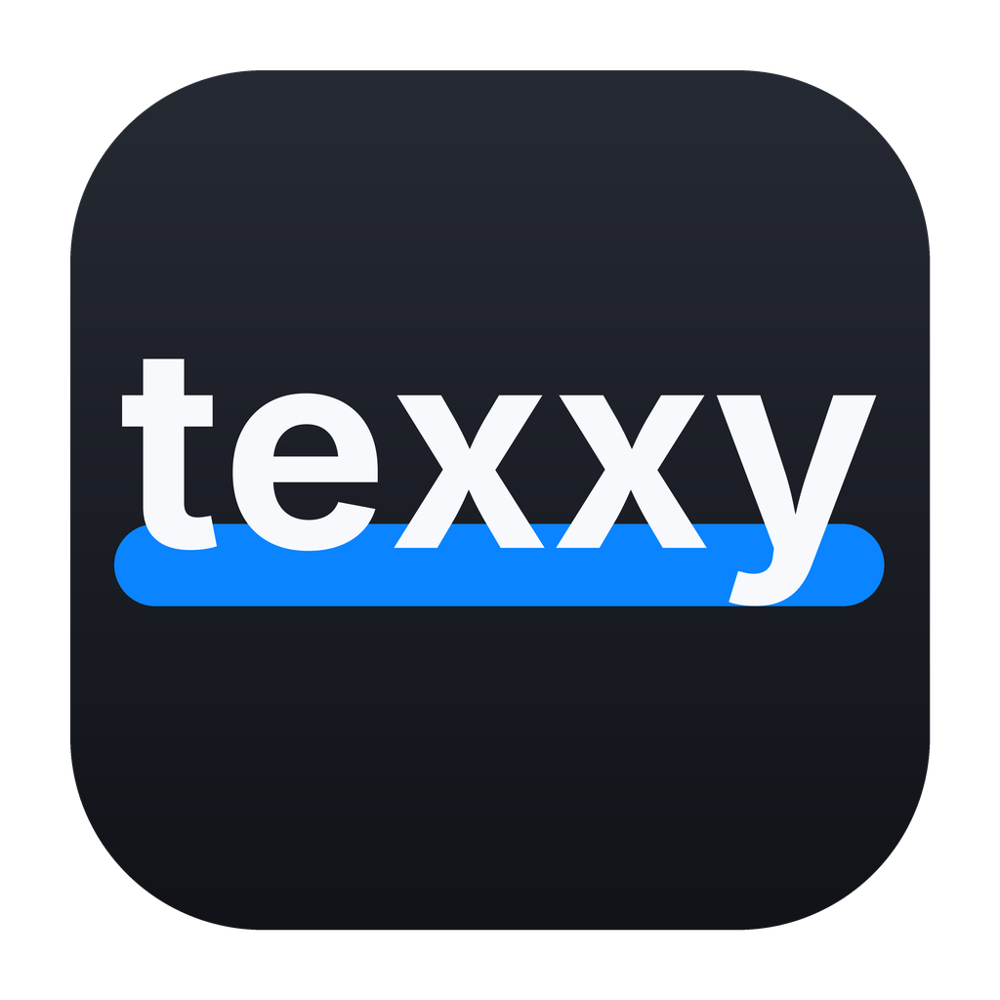

<p align="center">
  
</p>

<p align="center">
  <b>Offline karaoke caption burner for short-form video.</b><br>
  Drop in a video, review the transcript, and export with word-synced popup captions baked in.<br>
  No uploads, no accounts, no network after the one-time setup download.
</p>

<p align="center">
  <a href="LICENSE"></a>
  
  <a href="https://github.com/PaulBuitenhuis/texxy/actions/workflows/ci.yml"></a>
</p>

<p align="center">
  
</p>

## What it does

- **Word-synced "popup" captions.** A few words on screen at a time, with the
  spoken word lit up — the style popular on Reels/TikTok/Shorts.
- **Whisper transcription, offline.** Speech-to-text runs locally on your Mac
  via [whisper.cpp](https://github.com/ggerganov/whisper.cpp) with DTW word
  timings for tight sync.
- **Review before you burn.** Edit the transcript, tweak the style, and see a
  live preview before exporting.
- **All the caption styling you'd expect.** Font family, size, highlight/dim
  colours, box colour/opacity, rounded corners, drop shadow, vertical position
  and words-per-popup. Preferences persist between runs.
- **Also a CLI.** The same pipeline is available headlessly for scripting.

## Requirements

- macOS on Apple Silicon (arm64). (The code also runs on Linux for development;
  release builds target macOS.)
- `ffmpeg` + `ffprobe` and a whisper model — texxy downloads these on first run,
  or uses ones you already have.

## Install

Download the latest `texxy-<version>.dmg` from
[Releases](https://github.com/PaulBuitenhuis/texxy/releases), open it, and drag
**texxy** into **Applications**.

texxy is **not notarized** (no Apple Developer ID), so the very first launch
needs a round trip through Gatekeeper:

1. **Right-click (or Control-click) the app → Open**, then confirm **Open**.
   - or, in a terminal: `xattr -dr com.apple.quarantine /Applications/texxy.app`

After that it launches normally.

### First run

The first time you open texxy it shows a **Setup** screen. It downloads:

- `ffmpeg` + `ffprobe` (unless it finds them on your `PATH`, e.g. via Homebrew)
- a whisper model — **base.en** by default (~148 MB, fast); **small.en**
  (~488 MB, more accurate) is selectable on the same screen.

These are stored in `~/Library/Application Support/texxy/` — nothing else on
your machine is touched. From then on texxy is fully offline.

You can manage models from the **About** window: switch between installed ones,
download the other, or remove one texxy downloaded (a dev-checkout or
`$TEXXY_MODEL` model is never deleted).

Prefer the terminal? `texxy --setup` does the same thing.

## Using the app

1. **Drop a video** (or pass a path on the command line).
2. Wait while it extracts audio and transcribes. Progress is shown per phase.
3. **Review** the transcript: click a chunk to jump the preview to it, edit any
   text, and adjust the style panel on the right.
4. **Export** (button or **⌘E**). The result is written next to the input as
   `<name>_karaoke.mp4`, with a **Reveal in Finder** shortcut when it's done.

A transcript is cached per input file (and per model), so re-rendering or
restyling after the first pass is instant.

## Command line

```sh
texxy                                    # open the GUI
texxy video.mp4                          # GUI, pre-loaded with a video
texxy video.mp4 --headless               # run the whole pipeline, no GUI
texxy video.mp4 --words                  # print the (word, start, end) table and stop
texxy --setup                            # download ffmpeg + model, then exit
texxy --version                          # version + build hash
```

| Option | Effect |
|---|---|
| `--headless` / `--gui` | Force CLI / GUI mode when both would apply |
| `--words` | Print the word-timing table and stop |
| `--no-cache` | Ignore the cached transcript and re-transcribe |
| `-o, --output <path>` | Output path (default `<input>_karaoke.mp4`) |
| `--model <base.en\|small.en>` | Whisper model to use |
| `--png-dir <dir>` | Render caption states + filter script, skip encoding |
| `--font <family>` | `Libre Baskerville` (default) · `Inter` · `Nunito` |
| `--font-size <pct>` | Glyph size as % of frame height (default 3.4) |
| `--position <pct>` | Caption box centre as % of frame height (default 72) |
| `--words-per <n>` | Words per popup, 2–6 (default 3) |
| `--encoder <name>` | `auto` (default) · `vaapi` · `videotoolbox` · `x264` |
| `--graph` | Legacy overlay-graph encoder (higher RAM) |
| `--setup` | Download missing dependencies and exit |
| `-V, --version` | Print the version and build hash |

## Building from source

See [CONTRIBUTING.md](CONTRIBUTING.md) for the full developer setup (Rust,
cmake/clang for whisper.cpp, and packaging). In short:

```sh
cargo build --release          # -> target/release/texxy
scripts/package_macos.sh       # -> dist/texxy.app (+ .zip, .dmg)
```

## How it works

`ffprobe` (display dimensions + rotation) → audio extract → whisper
transcription with DTW word timings → chunking into popups → per-word caption
PNGs → export: ffmpeg decode → Rust compositing → hardware encode
(VideoToolbox on macOS; x264 fallback), audio copied.

Caption states are tight crops of just the caption box, so a few hundred of them
stay small and the export's memory stays flat. See
[CONTRIBUTING.md](CONTRIBUTING.md) for the deeper design notes.

## License

[MIT](LICENSE). Bundled fonts are under the SIL Open Font License — see
[`assets/fonts/OFL.txt`](assets/fonts/OFL.txt) and
[THIRD_PARTY_LICENSES.md](THIRD_PARTY_LICENSES.md).

texxy invokes `ffmpeg`/`ffprobe` and the whisper model as separate programs; it
does not link them, and they are not distributed with texxy.
